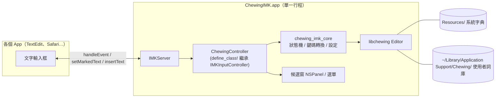

# macOS 新酷音（IMK + 純 Rust）Roadmap

最後更新：2026-11-12

## 目標與範圍

用純 Rust（`objc2` + `objc2-input-method-kit`）透過 InputMethodKit 做出 macOS 版新酷音。引擎直接使用 libchewing 的 `chewing` crate，行為盡量對齊 [windows-chewing-tsf](https://codeberg.org/chewing/windows-chewing-tsf)。

**範圍內**

- 注音輸入、組字（marked text）、候選選字、送出
- Windows 版的主要設定：鍵盤配置、選字鍵、單按 Shift 切換中英、全形／半形、簡繁轉換、自動學習
- 使用者詞庫，與 Windows 版使用相同的檔案格式
- `.app` 打包、安裝、簽章、公證

**不在範圍內（第一版）**

- 自動更新（Windows 版的 self-update）
- 詞庫編輯器 GUI（先用 `chewing-cli` 處理）
- iOS 與 iPadOS

**已驗證（2026-11-12）**

- `chewing 0.14.0-rc.1` 可以在 Apple Silicon 上用 Rust 1.99.1 編譯。它需要 rustc 1.95 以上，這台機器預設的 stable 是 1.90。
- 執行時需要字典檔：沒有字典時，`Editor::chewing(None, None)` 會回報 `Failed to find static_dict.bin`。
- crates.io 上有 `objc2-input-method-kit` 0.3.2。

## 架構



### Crate 切分

| Crate | 類型 | 內容 | 依賴 objc2？ |
|---|---|---|---|
| `chewing_imk` | bin | `main`、`NSApplication` 啟動、`IMKServer`、controller 類別、AppKit UI | 是 |
| `chewing_imk_core` | lib | 按鍵處理狀態機、`NSEvent` 鍵碼轉 chewing `Keycode`/`Keysym` 的對照表、設定結構與讀寫 | 否，可以在一般 `cargo test` 下測試 |
| `xtask` | bin | 產生字典、組裝 `.app`、安裝與重新載入、簽章與公證 | 否 |

主要依賴：`chewing`、`objc2`、`objc2-foundation`、`objc2-app-kit`、`objc2-input-method-kit`、`zhconv`。

### 與 Windows 版的對應

| Windows（windows-chewing-tsf） | macOS | 處理方式 |
|---|---|---|
| `chewing` crate | 同一個 crate | 直接使用 |
| `tip/src/text_service/chewing.rs`（約 1650 行） | `chewing_imk_core` | 重寫架構、移植按鍵規則（見「Core 邏輯：移植還是重寫」） |
| `key_event.rs`：scan code / VK 對照表 | `kVK_*` 對照表 | 重寫 |
| `edit_session.rs`：組字與送出 | `setMarkedText:` / `insertText:` | 重寫，邏輯簡單很多 |
| `ui_elements/candidate_list.rs` + D2D | 自製 `NSPanel` | 重寫 |
| `lang_bar.rs` | IMK `menu` + 輸入模式圖示 | 重寫 |
| `chewing_tip_core/config.rs`（Registry） | Application Support 底下的設定檔 | 沿用欄位定義，換掉儲存方式 |
| IPC、named pipe、ACL、AppContainer 沙盒 | — | 不需要：macOS 輸入法本身就是獨立行程 |
| `tsfreg` 註冊工具 | `TISRegisterInputSource` + 放進 `~/Library/Input Methods` | 寫在 xtask 和安裝程式裡 |
| `quirk.rs` | 各 app 特例處理 | Phase 5 視需要加入 |

## Roadmap

共分六個階段，前一個階段的完成標準就是下一個階段的門檻。Phase 1 完成就是可以自己日常使用的 MVP。

### Phase 0：專案骨架與開發流程

- [x] 加入 `rust-toolchain.toml`（固定 1.99.1），將專案改成 workspace：`crates/chewing_imk`、`crates/chewing_imk_core`、`xtask`
- [x] 用 `cargo xtask bundle` 產生 `.app`：`Info.plist`、`Contents/MacOS`、`Contents/Resources`，並做 ad-hoc 簽章
  - `InputMethodConnectionName`、`InputMethodServerControllerClass`、`TISInputSourceID`、`TISIntendedLanguage = zh-Hant`、`LSBackgroundOnly`、`LSMinimumSystemVersion = 14.0`
  - 目前沒有 `ComponentInputModeDict`：只有一個輸入模式，等需要多個模式（例如簡體）時再加
- [x] 最小 IMK server：`NSApplication` + `IMKServer initWithName:bundleIdentifier:`，再用 `define_class!` 繼承 `IMKInputController`。`handleEvent:client:` 先只記 log，然後回傳 NO
  - 要在建立 `IMKServer` 之前先呼叫 `ChewingController::class()`，確保類別已經註冊到 ObjC runtime；類別名稱必須和 `Info.plist` 裡寫的一致
- [x] `cargo xtask install`：複製到 `~/Library/Input Methods`、`pkill` 舊行程，再執行 `ChewingIMK --register`（`TISRegisterInputSource` + `TISEnableInputSource`）。另有 `cargo xtask uninstall`
- [x] 用 `os_log` 記錄 log（`oslog` crate），用 `cargo xtask log` 即時查看

完成標準：可以在系統設定加入輸入法並切換到它，從 log 看得到按鍵事件。

**已完成（2026-11-12）**：已在 macOS 上切換到新酷音並打字，log 收到 `keyDown`、`flagsChanged`、`activateServer`、`deactivateServer` 事件。地球（Fn）鍵切換輸入法時是 `flagsChanged keyCode=63`。

### Phase 1：能打字（MVP）

- [x] 字典：`cargo xtask fetch-data` 下載固定版本的 libchewing-data Generic zip、驗證 sha256，`bundle` 時複製到 `Contents/Resources/Dictionary`。使用者詞庫用 libchewing 預設的 `~/Library/Application Support/im.chewing.Chewing`，和 `chewing-cli` 共用
- [x] `chewing_imk_core`：`handle_key` 狀態機，移植 Windows 版 `on_test_keydown` / `on_keydown` 的放行與大小寫規則（快捷鍵與單按 Shift 留到 Phase 2）；`handle_modifiers` 也留到 Phase 2
- [x] 鍵碼轉換：`NSEvent.keyCode`（`kVK_*`）對到 chewing 的 X11 `Keycode`，`charactersIgnoringModifiers` 對到 `Keysym`，再加上 modifier 狀態。AppKit 功能鍵的私用區字元（U+F700–U+F8FF）不當成可列印字元
- [x] 呼叫 `process_keyevent`，依 `EditorKeyBehavior` 決定要不要吞掉按鍵
- [x] 組字：`setMarkedText:selectionRange:replacementRange:`，底線屬性來自 `markForStyle:atRange:`，游標換算成 UTF-16 位置
- [x] 送出：`insertText:replacementRange:`
- [x] 候選窗：最陽春的自製 nonactivating `NSPanel`，列出候選字、選字鍵、頁碼，位置從 `attributesForCharacterIndex:lineHeightRectangle:` 取得，下方空間不夠時改放上方
- [x] 生命週期：`activateServer:` 時要求 client 使用 ABC 鍵盤配置；`deactivateServer:`、`commitComposition:` 時送出已轉換的文字（還沒組成字的注音丟掉）並關閉候選窗
- [x] `cargo xtask test`：用真字典跑 core 的單元測試（18 個）

完成標準：在 TextEdit、Safari、Terminal 都能打出「新酷音輸入法」並選字，切換 app 時不會留下殘字。

**進度（2026-11-12）**：已在 Claude 桌面 app 的輸入框打出「新酷音輸入法」並用候選窗選字；輸入框靠近螢幕底部時，候選窗會正確改放上方。TextEdit、Safari（網址列）、Terminal 也都手動測過：組字有底線，候選窗出現在正在選的字下方，左緣對齊該字。按 Enter 送出也確認過：第一次 Enter 由輸入法處理並送出文字，第二次 Enter 放行給 app 換行。切換 app 時的送出是從 log 的 `commitComposition` 確認。

**隱私**：libchewing 會在 log 記錄每個按鍵字元（info）和轉換出的詞句（debug），其中 info 會被 oslog 對應到 os_log 會存到磁碟的 Default 等級。`ChewingIMK` 的 logger 現在會擋掉 `chewing::*` 低於 Warn 的訊息。

**測試方式的限制**：用自動化工具（Claude 的電腦操作）送出的按鍵會繞過 macOS 的輸入法系統，新酷音收不到；用 `TISSelectInputSource` 從命令列切換輸入法，前景 app 也不會跟著切到第三方輸入法。所以實機測試目前只能手動進行。

### Phase 2：行為對齊 Windows 版

- [x] 把 Windows 版 `on_test_keydown` / `on_keydown` 的其餘規則移植到 `chewing_imk_core`：快捷鍵（`toggle_simplified_chinese`、`toggle_hsu_keyboard`、`text`）、libchewing 的提示訊息、`auto_commit_threshold = 50`
- [x] 單按 Shift 切換中英：`recognizedEvents:` 已含 `NSEventMaskFlagsChanged`，用 `NSEvent.timestamp` 計算按住時間（預設 200 ms 內放開才算）。Shift 按住期間有其他按鍵或修飾鍵就不算。Chromium 架構的 app（Electron，例如 Claude、VS Code）每個修飾鍵事件會送兩次，重複的 Shift 按下視為同一次
- [x] Caps Lock：`enable_caps_lock` 開啟時，中英模式跟著 Caps Lock 狀態；`activateServer:` 時同步一次
- [x] 全形／半形（`Shift+Space`，由 libchewing 處理；另有 `toggle_shape_mode()` 供 Phase 3 的選單使用），以及用 `zhconv` 做簡體輸出（組字與送出都轉換，候選字維持繁體，與 Windows 版相同）
- [x] 鍵盤配置（`KeyboardLayoutCompat`）與「模擬英文鍵盤」（Dvorak、Colemak 等 keymap）
- [x] `EditorOptions` 各項：選字鍵、每頁候選數、空白鍵選字、自動學習等
- [x] 提示視窗：切換中英、簡繁、鍵盤配置時，在游標附近顯示 0.5 秒（Windows 版的 Notification；原列在 Phase 3，因為切換中英需要回饋而提前）
- [x] 單元測試：core 共 35 個

**實機測試（2026-11-12）**：Safari、Terminal、TextEdit 的單按 Shift 和簡繁切換都正常。Claude 起初切不了中英，原因是上述重複事件；修正後已重測，log 確認每次 Shift 只切換一次。Phase 2 完成。

完成標準：對照 Windows 版 `ChewingTsfConfig` 的每個欄位，都已經實作，或明確標註不支援。

| 欄位 | 狀態 |
|---|---|
| `switch_lang_with_shift`、`shift_key_sensitivity` | 已實作 |
| `enable_caps_lock`、`lock_chinese_on_caps_lock` | 已實作。macOS 若開了「使用大寫鎖定鍵切換 ABC」，Caps Lock 會先被系統拿走（待決定 #12） |
| `show_notification` | 已實作 |
| `enable_fullwidth_toggle_key`、`default_full_space`、`default_english` | 已實作 |
| `enable_auto_learn`、`auto_learn_user_history`、`auto_learn_new_words` | 已實作 |
| `esc_clean_all_buf`、`full_shape_symbols`、`upper_case_with_shift` | 已實作 |
| `add_phrase_forward`、`phrase_choice_rearward`、`auto_wrap_cursor`、`advance_after_selection` | 已實作 |
| `easy_symbols_with_shift`、`easy_symbols_with_shift_ctrl` | 已實作 |
| `sort_candidates_by_frequency`、`show_cand_with_space_key`、`cycle_first_n_selects` | 已實作 |
| `sel_key_type`、`cand_per_page`、`conv_engine` | 已實作 |
| `output_simp_chinese` | 已實作 |
| `simulate_english_layout` | 已實作 |
| `keyboard_layout` | 已實作。但 Dvorak、Colemak、Carpalx、Workman、DvorakHsu 這幾種是以「系統鍵盤配置產生的字元」為準，而我們在 `activateServer:` 要求 client 用 ABC，所以 Phase 4 讀設定時要改成對應的系統配置 |
| `keybind` | 已實作；`selecting_unlearn_phrase`（`Ctrl+Delete`）要等 Phase 3 的游標選字 |
| `cursor_cand_list`、`cand_per_row` | Phase 3（候選窗） |
| `font_size`、`font_family`、`font_*_color`、`cand_list_border_color`、`notify_*_color` | Phase 3（外觀設定） |
| `modified_timestamp`，以及 `Config` 的 `symbols_dat`、`swkb_dat` | Phase 4（設定檔、自訂符號表） |
| `sync_lang_mode_openclose` | 不支援：這是 TSF 的鍵盤開關（keyboard open/close）狀態，macOS 沒有對應概念，切換輸入法即可 |
| `auto_check_update_channel`、`update_info_url`、`last_update_check_time` | 不支援：自動更新不在第一版範圍 |

### Phase 3：自製 UI

- [x] 候選窗完善：
  - 格狀排列，每列 `cand_per_row` 個（預設 3，與 Windows 版相同；設成 1 就是直排），欄寬用實際字型量出最寬的候選字
  - 游標選字（`cursor_cand_list`，預設開啟）：方向鍵移動反白、Enter 選字；`Ctrl+Delete` 從使用者詞庫刪除反白的詞（Mac 鍵盤是 `fn+Ctrl+Delete`）
  - 字型與大小（`font_family`、`font_size`，預設系統字型 16 pt）
  - 顏色用系統色（`labelColor`、`selectedContentBackgroundColor` 等），自動跟著淺色／深色模式。Windows 版的自訂顏色欄位暫不支援，Phase 4 視需要再加
  - 下方空間不夠時改放上方，並限制在游標所在螢幕的可見範圍內
- [x] 切換中英時的小提示（對應 Windows 版的 Notification），Phase 2 已先做出基本版
- [x] 輸入法選單：由 `menu` 回傳 `NSMenu`，項目照 Windows 版的右鍵選單：英數模式、輸出全形英數字母、輸出簡體中文（都有勾選狀態）、使用說明、網路辭典、官方網站、詞庫錯誤回報。「設定」與「編輯使用者詞庫」等 Phase 4；「軟體錯誤回報」等 repo 位置確定後再加
- [x] 輸入模式圖示：選單列使用 template 圖檔「酷」，自動適應淺色／深色。Windows 版會依中英模式換圖示，macOS 要做到同樣效果需要拆成多個輸入模式（`ComponentInputModeDict`），目前不做，改用提示視窗表示

完成標準：候選窗在 Retina、多螢幕、全螢幕 app 中位置都正確。

**實機測試（2026-11-12）**：在 Retina 螢幕上確認格狀候選窗、方向鍵反白、Enter 選字、輸入法選單的勾選與切換、網路辭典連結都正常。多螢幕與全螢幕 app 尚未測試（手邊沒有外接螢幕）；程式會把候選窗限制在游標所在螢幕的可見範圍內，但實際效果待有環境時確認，列入 Phase 5 的相容性測試。

### Phase 4：設定與詞庫

- [ ] 設定儲存在 `~/Library/Application Support/` 底下，欄位對應 `ChewingTsfConfig`
- [ ] 設定熱重新載入：在 `activateServer:` 時檢查檔案修改時間，做法對應 Windows 版的 `reload_if_needed`
- [ ] 偏好設定視窗
- [ ] 使用者詞庫的匯入與匯出

完成標準：修改設定後不需要重新登入就能生效。

### Phase 5：相容性與發佈

- [ ] 多螢幕與全螢幕 app 的候選窗位置（Phase 3 遺留）
- [ ] 相容性測試矩陣：TextEdit、Safari、Chrome、Firefox、Terminal、iTerm2、VS Code、Word、Spotlight、密碼欄位
- [ ] 個別 app 的特例處理模組，對應 Windows 版的 `quirk.rs`
- [ ] Universal binary：分別編譯 `aarch64-apple-darwin` 與 `x86_64-apple-darwin`，再用 `lipo` 合併
- [ ] Hardened runtime 簽章、`notarytool` 公證、staple，用 `pkgbuild` 與 `productbuild` 做安裝包
- [ ] 在 macOS runner 上跑 CI

完成標準：在乾淨的 macOS 上可以直接安裝，Gatekeeper 不會擋下。

## 需要決定的事項

越前面的越早需要決定。標「Phase 0 前」的事項會影響 bundle ID 或授權，之後很難改。

### 已決定（2026-11-12）

| # | 事項 | 決定 | 備註 |
|---|---|---|---|
| 1 | 授權 | **GPL-3.0-or-later** | 和 windows-chewing-tsf 一致，可以直接移植它的程式碼。需要補上 `COPYING` 檔，並在 `Cargo.toml` 加 `license = "GPL-3.0-or-later"` |
| 2 | 專案歸屬 | **先放個人 repo，做到 MVP 後再向上游提案** | 上游是 Codeberg 的 chewing org |
| 3 | Bundle ID 與 `TISInputSourceID` | **`im.chewing.inputmethod.Chewing`** | `im.chewing` 是上游的命名空間：**公開發佈前**要先取得 chewing 團隊同意，最晚在 Phase 5 之前。如果上游不同意，要在第一次公開發佈前改掉，以免使用者被迫重新加入輸入法 |
| 4 | 最低 macOS 版本 | **macOS 14 Sonoma 以上** | `Info.plist` 的 `LSMinimumSystemVersion = 14.0`，Rust 端設定 `MACOSX_DEPLOYMENT_TARGET=14.0` |
| 6 | `Editor` 實例數量 | **所有 client 共用一個** | 切換 client 時送出或清除組字，避免多個 `Editor` 同時開啟使用者詞庫 |
| 7 | 候選窗策略 | **一開始就自製 `NSPanel`** | 不使用 `IMKCandidates`。Phase 1 先做最陽春的版本（直排文字、選字鍵、翻頁），Phase 3 再補外觀與細節 |
| 8 | 字典來源 | **沿用 Windows 版做法：下載 libchewing-data 的 Generic 發佈檔** | Windows 版固定使用 [`libchewing-data-2026.11.1-Generic.zip`](https://codeberg.org/chewing/libchewing-data/releases/download/v2026.11.1/libchewing-data-2026.11.1-Generic.zip)，並以 sha256 驗證（見 windows-chewing-tsf 的 `nix/libchewing-data.nix`）。裡面有 `static_dict.bin`、`rare_dict.bin`、`static_words.bin`、`static_lm.bin`、`swkb.dat`、`symbols.dat`，和平台無關。xtask 下載、驗證後解壓到 `Contents/Resources/Dictionary` |
| 9 | Core 邏輯來源 | **重寫架構、移植規則** | 自己設計平台無關的 `chewing_imk_core`（輸入按鍵事件，回傳 `handled` 加上 `Action` 列表），再把 Windows 版 `on_test_keydown` / `on_keydown` 的按鍵判斷規則逐條移植過來，每條規則配一個測試。理由見下方「Core 邏輯：移植還是重寫」 |

### 待決定

| # | 事項 | 選項 | 建議 | 何時要定 |
|---|---|---|---|---|
| 5 | CPU 架構 | 只有 arm64／Universal | Universal：成本只是多編一次再 `lipo` | Phase 5 |
| 10 | 設定格式 | 設定檔（TOML 或 JSON）／`NSUserDefaults` | 用 Application Support 底下的設定檔，讓 `chewing_imk_core` 保持平台無關、可以測試 | Phase 4 |
| 11 | 偏好設定 UI | 輸入法行程內的視窗／獨立 app | 輸入法行程內的視窗，從輸入法選單打開，不需要額外的打包與 IPC | Phase 4 |
| 12 | Caps Lock 行為 | 交給 macOS（切換到 ABC）／輸入法自己處理 | 預設交給系統，並在文件說明；要和 Windows 版行為一致的話再加設定項 | Phase 2 |
| 13 | 發佈管道 | `.pkg`／zip + Homebrew cask／App Store | `.pkg` 加 Homebrew cask。App Store 需要沙盒，對輸入法限制太多 | Phase 5 |
| 14 | Apple Developer 帳號 | 個人／組織 | 簽章與公證每年要 US$99；組織帳號較適合長期維護，和 #2 一起決定 | Phase 5 |

### Core 邏輯：移植還是重寫

`tip/src/text_service/chewing.rs`（約 1650 行）其實混了兩種東西：

| 部分 | 大概位置 | 在 macOS 上 |
|---|---|---|
| **按鍵判斷規則**：Shift／Ctrl／Alt／Caps Lock 何時放行、暫時英文模式、大小寫規則、全半形切換、選字鍵對應、快捷鍵動作、刪除使用者詞 | `on_test_keydown`、`on_keydown`（約 360 行）、`map_sel_key`、`build_editor_from_cfg` | **幾乎全部適用**。這是多年使用者回報累積下來的行為，重寫很容易漏掉 |
| **TSF 結構**：先 test 再 keydown 的兩段式呼叫、`ITfContext` 與 edit session、compartment、語言列、thread focus、`Cell`/`RefCell` 重入保護 | 其餘大部分 | **完全不適用**。IMK 只有一次 `handleEvent:client:`，組字直接呼叫 `setMarkedText:` |

所以：

- **直接 fork 後修改不划算**：TSF 的呼叫結構滲透在每個函式裡（幾乎每個函式都要帶 `context: &ITfContext`），改完等於重寫，還會留下 TSF 的包袱。
- **完全重寫風險高**：上表第一列的細節（例如 Ctrl+數字在組字中要攔下來加詞、Caps Lock 和 `lock_chinese_on_caps_lock` 的組合）不看原始碼很難重現。

建議的做法是讓 core 變成純函式風格的狀態機，平台層只負責執行結果：

```rust
pub struct KeyResponse {
    pub handled: bool,          // 回給 handleEvent: 的 YES / NO
    pub actions: Vec<Action>,
}

pub enum Action {
    SetMarkedText { text: String, cursor: usize },
    Commit(String),
    ShowCandidates(CandidatesView),
    HideCandidates,
    ShowNotice(String),
    LangModeChanged(LangMode),
}

impl Core {
    pub fn handle_key(&mut self, ev: KeyEvent) -> KeyResponse;
    pub fn handle_modifiers(&mut self, ev: ModifierEvent) -> KeyResponse; // flagsChanged，處理單按 Shift
    pub fn on_deactivate(&mut self) -> KeyResponse;
}
```

macOS 和 Windows 不同、需要另外設計的地方：

- **Command 鍵**：Windows 沒有對應的規則，一律放行給 app 處理快捷鍵。
- **Option 鍵**：等同 Windows 的 Alt，放行。
- **單按 Shift**：沒有 keyup 事件，改從 `flagsChanged` 判斷。
- **Caps Lock**：系統可能先拿去切換到 ABC 輸入法（見待決定 #12）。
- **唯讀欄位**：TSF 有 `is_context_mutable` 可以判斷，IMK 沒有對應的 API，只能依 client 的行為處理。

## 風險與已知坑

- **自製候選窗**：已決定不用 `IMKCandidates`，所以 Phase 1 就要處理 `NSPanel` 不搶焦點、浮在全螢幕 app 之上、座標換算（client 回傳的是螢幕座標，原點在左下）等問題。
- **App 相容性**：已知 Chromium／Electron app 會把每個修飾鍵事件（`flagsChanged`）送兩次，相隔約 2–4 ms。Terminal、Electron 與瀏覽器對 marked text 的處理各有不同，例如 replacementRange 和游標位置。測試矩陣要盡早建立。
- **Secure Input**：密碼欄位，或啟用 Secure Keyboard Entry 的 Terminal，會讓輸入法收不到按鍵。這是系統行為，不是 bug。
- **開發迴圈**：每次改完都要重新安裝並 kill 掉行程，有時還得重新登入才會生效。Phase 0 就要把 `cargo xtask install` 做到一個指令完成。
- **objc2 子類別**：`define_class!` 的 ivar 與 `Retained` 生命週期要小心；IMK 透過 ObjC runtime 用類別名稱建立 controller，名稱打錯不會在編譯時報錯。
- **libchewing 版本**：目前是 `0.14.0-rc.1`，Windows 版還用 `[patch]` 指向 git，API 可能還會變。要鎖定版本，升級時一併跑測試。
- **授權**：一旦移植 Windows 版的程式碼，整個專案就必須是 GPL-3.0-or-later。

## 參考資料

- [windows-chewing-tsf](https://codeberg.org/chewing/windows-chewing-tsf)
- [libchewing（`chewing` crate）](https://docs.rs/crate/chewing/latest)
- [Apple InputMethodKit 文件](https://developer.apple.com/documentation/inputmethodkit)
- [objc2-input-method-kit](https://docs.rs/objc2-input-method-kit)
- [vChewing macOS](https://gitee.com/vChewing/vChewing-macOS/)：成熟的 macOS 注音輸入法，可以參考 IMK 的各種坑
- [IMKSwift](https://gitee.com/vChewing/IMKSwift)：vChewing 團隊的 IMK Swift 封裝
